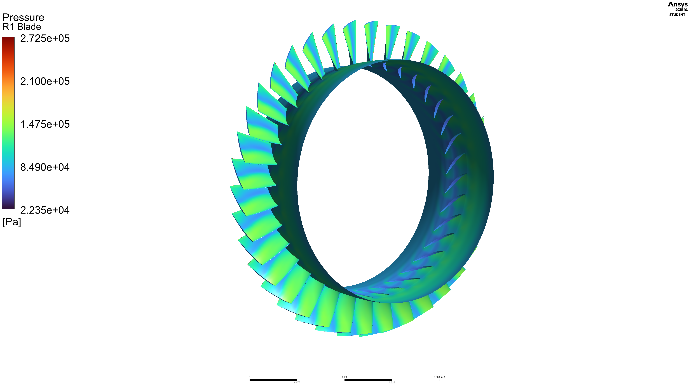
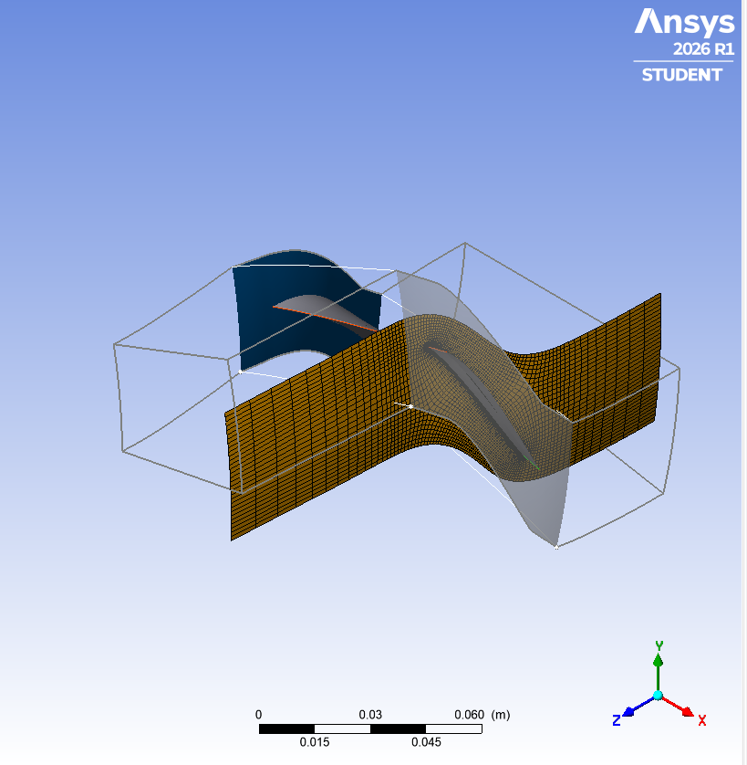
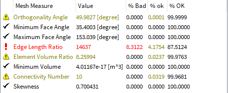
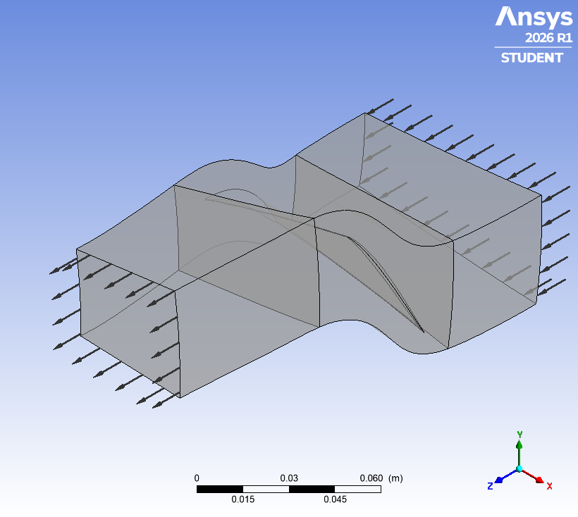
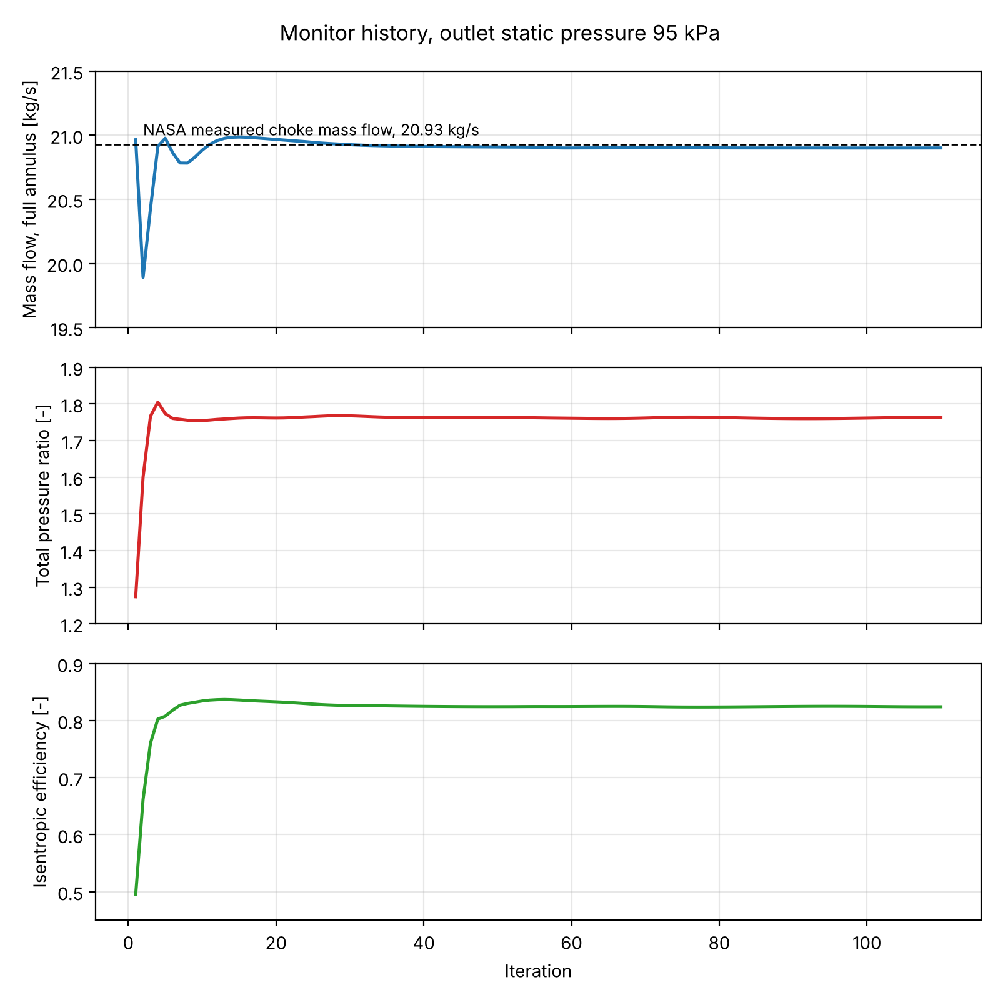
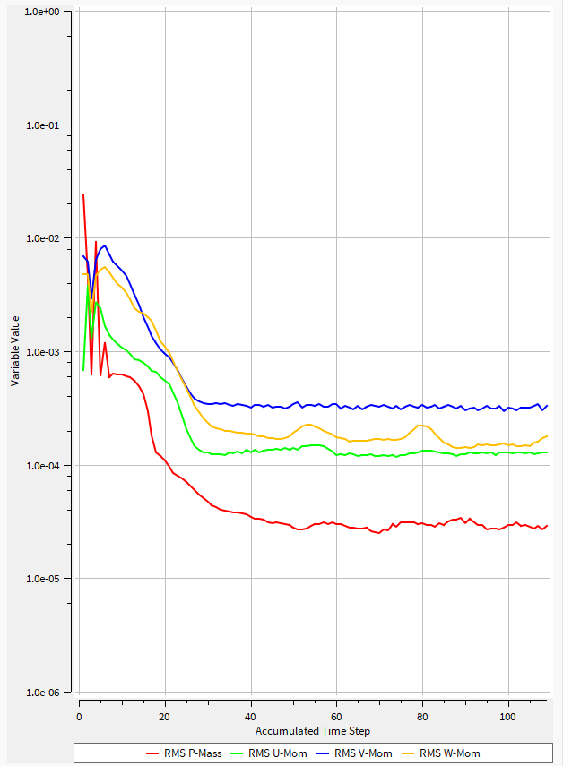
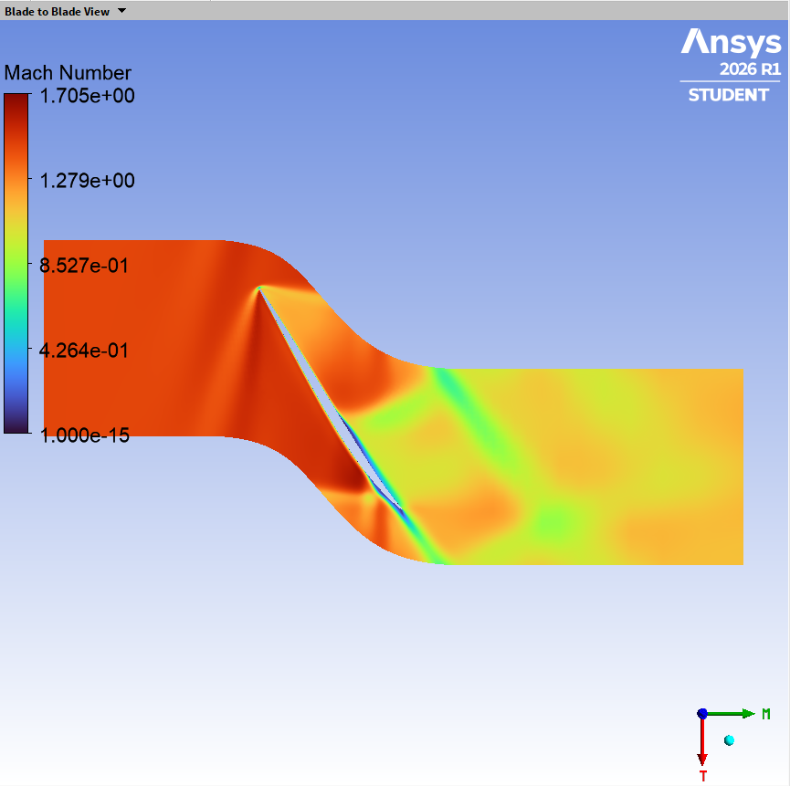
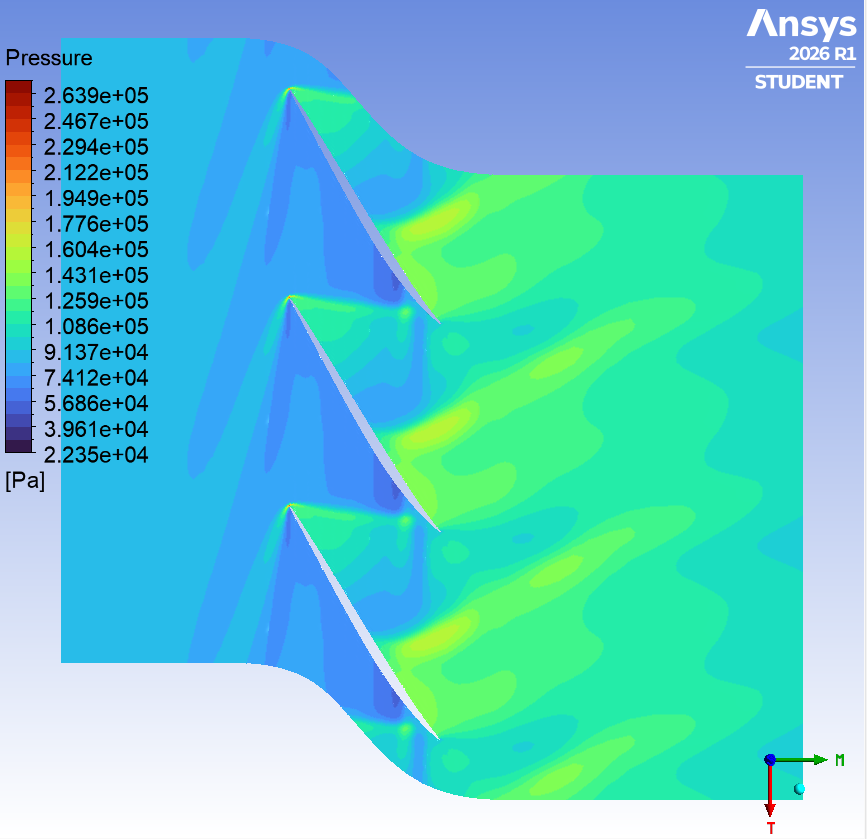
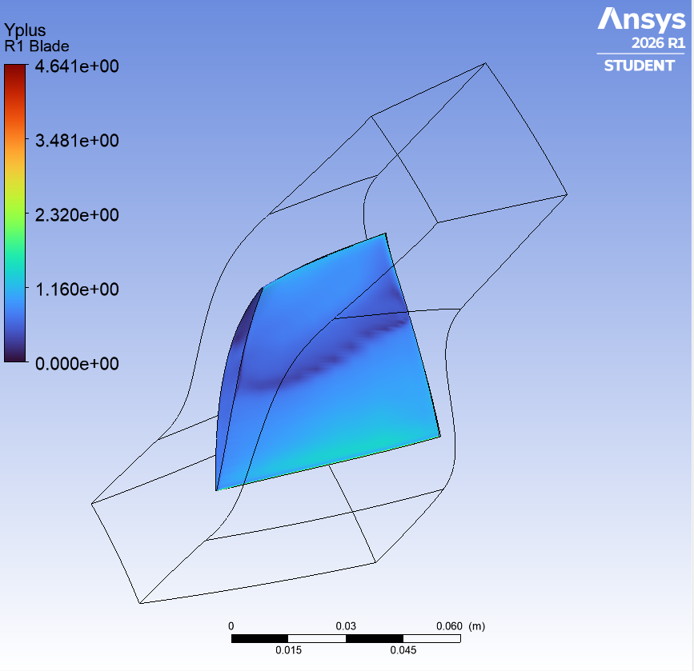

# NASA Rotor 37: CFD of a transonic axial compressor rotor (Ansys TurboGrid + CFX)



**Enzo Alves Zanatta** · Mechanical Engineer, CFD & Simulation · independent validation project · November 2026

A steady RANS simulation of NASA Rotor 37, the transonic axial compressor rotor that became the classic blind test case for turbomachinery CFD. The full workflow ran in Ansys 2026 R1 (Student): a structured single passage mesh with the measured tip clearance and y+ ≈ 1, a rotating frame of reference, SST k-ω turbulence and total energy compressible flow. At the near choke operating point it predicts a **full annulus mass flow of 20.90 kg/s, 0.14% below the NASA measured choke mass flow of 20.93 kg/s**, and it captures the supersonic inflow and the passage shock.

## Key results

| Quantity | Simulation (outlet static pressure 95 kPa) | Reference |
| --- | --- | --- |
| Mass flow, full annulus | **20.90 kg/s** | 20.93 kg/s, measured choke flow ([CFD Letters, 2022](https://semarakilmu.com.my/journals/index.php/CFD_Letters/article/download/460/554/4787)): **−0.14%** |
| Total pressure ratio | 1.762 | 2.106 at the design point, a different operating point |
| Total temperature ratio | 1.213 | not measured at this point |
| Isentropic efficiency, total to total | 0.824 | 0.877 peak; efficiency falls towards choke |
| Inlet relative Mach number, 90% span | 1.4 to 1.5 | 1.48 at the tip ([arXiv 2508.07644](https://arxiv.org/pdf/2508.07644)) |
| y+ on the blade | about 1 over most of the blade, 4.6 max | below about 1 to 2 for SST without wall functions |

The pressure ratio and efficiency belong to the near choke point. They are not compared with the design point values, which need a higher back pressure (see [Scope and next steps](#scope-and-next-steps)).

## 1. The test case

NASA Rotor 37 is the inlet rotor of a high pressure ratio core compressor, designed and tested at NASA Lewis (now Glenn). It was the ASME/IGTI blind test case for turbomachinery CFD in 1994 and is documented in AGARD-AR-355. At design speed its blade tips run supersonic relative to the incoming air, so a shock stands in every blade passage. That shock and its interaction with the boundary layer and the tip leakage flow make the case hard to predict.

| Parameter | Value |
| --- | --- |
| Number of blades | 36 |
| Design rotational speed | 17,188.7 rpm (1,800 rad/s) |
| Design mass flow | 20.19 kg/s |
| Design total pressure ratio | 2.106 |
| Measured choke mass flow | 20.93 kg/s |
| Peak adiabatic efficiency | 0.877 |
| Tip speed | 454.14 m/s |
| Inlet relative Mach number at the tip | 1.48 |
| Tip clearance | 0.356 mm |
| Hub to tip radius ratio | 0.70 |

Sources: [arXiv 2508.07644](https://arxiv.org/pdf/2508.07644), [NASA TM-2009-215627](https://ntrs.nasa.gov/api/citations/20090038700/downloads/20090038700.pdf), [CFD Letters 14(3), 2022](https://semarakilmu.com.my/journals/index.php/CFD_Letters/article/download/460/554/4787), [AGARD-AR-355](https://www.sto.nato.int/publications/AGARD/AGARD-AR-355/AGARD-AR-355.pdf).

## 2. Workflow

```
Geometry (hub, shroud and blade curve files from the Ansys TurboGrid Rotor 37 tutorial)
   └─ Ansys TurboGrid: single passage structured mesh, tip gap, y+ ≈ 1
        └─ Ansys CFX-Pre (Turbo Mode): rotating domain, periodicity, boundary conditions
             └─ Ansys CFX-Solver: steady RANS, double precision, 4 MPI processes
                  └─ Ansys CFD-Post (Turbo): performance, blade to blade and 3D views
```

All 36 blades are identical and equally spaced, so the flow is periodic every 10° (360°/36). One blade passage with rotational periodic boundaries represents the whole rotor at 1/36 of the cost. The full annulus pictures are graphical copies of that one passage.

## 3. Mesh



| Setting | Value |
| --- | --- |
| Mesher | Ansys TurboGrid, ATM Optimized topology |
| Domains | inlet, blade passage and outlet regions, one passage |
| Tip clearance | 0.356 mm, constant normal distance (the measured clearance) |
| Target passage size | 500,000 nodes |
| Total size | **840,909 nodes, 803,749 hexahedral elements** |
| Near wall spacing | first element offset from y+ = 1, Reynolds number 1.5 × 10⁶ |
| Boundary layer expansion rate | 1.3 |

The Reynolds number used to size the first cell is based on the tip chord (about 5.6 cm) and the relative inlet velocity (about 450 m/s).



| Quality measure | Value | Assessment |
| --- | --- | --- |
| Minimum face angle | 35.4° | good (limit about 15°) |
| Maximum face angle | 153.0° | good |
| Minimum orthogonality angle | 49.98° | at the 50° "OK" threshold in 0.0001% of elements |
| Skewness, max | 0.70 | good |
| Element volume ratio, max | 8.26 | good |
| Minimum volume | positive | no inverted elements |
| Edge length ratio, max | 14,637 | high, expected: see below |

The high edge length ratio comes from the y+ ≈ 1 requirement. Next to the hub and shroud the cells are micrometres thick but millimetres long, especially in the inlet and outlet regions. The limit was raised accordingly and the solver was run in double precision.

## 4. Numerical setup



| Item | Setting |
| --- | --- |
| Solver | Ansys CFX 2026 R1 (Student), steady state, double precision |
| Frame of reference | rotating domain, 17,188.7 rpm about the z axis |
| Fluid | air as an ideal gas; reference pressure 0 Pa, so all pressures are absolute |
| Heat transfer | total energy |
| Turbulence | Shear Stress Transport (SST k-ω), automatic wall treatment |
| Inlet | total pressure 101,325 Pa, total temperature 288.15 K, flow normal to the boundary |
| Outlet | static pressure 95,000 Pa |
| Blade and hub | no slip, adiabatic walls rotating with the domain |
| Shroud | no slip wall, stationary in the absolute frame (Counter Rotating Wall option) |
| Tip gap | general grid interface across the gap |
| Pitchwise sides | rotational periodicity, 10° |
| Advection scheme | high resolution |
| Timescale control | physical timescale 5 × 10⁻⁴ s (about 1/ω) |

### Governing equations

The solver integrates the Reynolds averaged mass, momentum and total energy equations in the frame rotating with the blades:

```math
\frac{\partial \rho}{\partial t} + \nabla \cdot (\rho \mathbf{W}) = 0
```

```math
\frac{\partial (\rho \mathbf{W})}{\partial t} + \nabla \cdot (\rho \mathbf{W} \otimes \mathbf{W}) = -\nabla p + \nabla \cdot \boldsymbol{\tau}_{\mathrm{eff}} - 2\rho\, \boldsymbol{\omega} \times \mathbf{W} - \rho\, \boldsymbol{\omega} \times (\boldsymbol{\omega} \times \mathbf{r})
```

```math
\frac{\partial (\rho I)}{\partial t} + \nabla \cdot (\rho \mathbf{W} I) = \nabla \cdot (\lambda_{\mathrm{eff}} \nabla T) + \nabla \cdot (\boldsymbol{\tau}_{\mathrm{eff}} \cdot \mathbf{W}), \qquad I = h + \tfrac{1}{2}|\mathbf{W}|^2 - \tfrac{1}{2}|\boldsymbol{\omega} \times \mathbf{r}|^2
```

Here **W** is the relative velocity and ω the angular velocity. The last two terms of the momentum equation are the Coriolis and centrifugal forces, and I is the rothalpy, which is conserved along a streamline in an adiabatic, inviscid rotor. The SST k-ω model closes the Reynolds stresses: k-ω near the walls, k-ε in the free stream, and a limiter on the shear stress that improves the prediction of separation in adverse pressure gradients.

### Performance quantities

Total quantities are taken in the stationary frame and mass flow averaged over the inlet and outlet; γ = 1.4:

```math
\Pi = \frac{\bar{p}_{0,\mathrm{out}}}{\bar{p}_{0,\mathrm{in}}}, \qquad \tau = \frac{\bar{T}_{0,\mathrm{out}}}{\bar{T}_{0,\mathrm{in}}}, \qquad \eta_{is} = \frac{\Pi^{(\gamma-1)/\gamma} - 1}{\tau - 1}, \qquad \dot{m} = 36\, \dot{m}_{\mathrm{passage}}
```

## 5. Convergence



| Monitor | Mean, last 50 exported iterations | Peak to peak variation |
| --- | --- | --- |
| Mass flow | 20.901 kg/s | 0.007% |
| Total pressure ratio | 1.762 | 0.24% |
| Total temperature ratio | 1.213 | 0.11% |
| Isentropic efficiency | 0.824 | 0.16% |



The RMS residuals settle after about 30 iterations: mass about 3 × 10⁻⁵, momentum 1 to 3 × 10⁻⁴, energy about 3 × 10⁻⁴. They then hold a plateau, as is usual for a transonic case where the shock moves very slightly from one iteration to the next. The solution is treated as converged on the integral quantities: mass flow steady to 0.01% and pressure ratio and efficiency to 0.25%. The monitor history in this repository covers the first 110 iterations, exported from the CFX-Solver Manager. The run then continued to the iteration limit.

## 6. Flow field

### Relative Mach number at 90% span



In the blade's frame the air arrives at Mach 1.4 to 1.5, in line with the design tip value of 1.48. Expansion and compression waves fan out from the leading edge. Because this point is near choke, the passage shock has been swallowed deep into the passage, towards the trailing edge: the sharp drop from supersonic (red) to subsonic (green) flow. Behind it the flow leaves the rotor at about Mach 0.8 to 1.0. As the back pressure rises towards the design point, the shock moves forward and stands near the passage inlet.

### Static pressure across three passages



The pressure rises in steps across the passage. It is lowest on the forward suction side, where the flow expands, and jumps through the shock. The view shows three of the 36 identical passages.

### y+ and the shock footprint on the blade



y+ stays at about 1 over most of the blade (maximum 4.6, at the edges), so the SST model resolves the boundary layer down to the wall instead of relying on wall functions. The dark band running spanwise across the suction side is the shock's footprint. There the shock thickens the boundary layer, wall shear drops and y+ drops with it.

## Scope and next steps

This study covers **one operating point near choke** on the design speed characteristic, with one mesh. It matches the measured choke mass flow and reproduces the expected shock structure. It is not yet a full validation of Rotor 37. That needs:

1. **The speed line**, from choke to near stall, by raising the outlet static pressure: total pressure ratio and efficiency against mass flow, compared with the AGARD-AR-355 data.
2. **A mesh independence study** with three meshes (for example about 0.4, 0.84 and 1 million nodes, within the licence limit) and the Grid Convergence Index (Celik et al., 2008).
3. **Radial profiles** of total pressure and temperature at the measurement stations, against the measured profiles.
4. **One way fluid structure interaction**: blade stress under centrifugal and aerodynamic loads in Ansys Mechanical, and a prestressed modal analysis with a Campbell diagram. The script `scripts/blade_step.py` builds the solid blade from the same curve files.

## Repository contents

| Path | Content |
| --- | --- |
| `images/` | figures in this report |
| `data/monitor_history.csv` | mass flow, PR, TR and efficiency monitors, exported from CFX-Solver Manager |
| `scripts/plot_monitors.py` | reproduces the monitor figure and the convergence statistics |
| `scripts/blade_step.py` | builds a solid blade (STEP) from the TurboGrid profile curves, for structural analysis |

## References

1. Dunham, J. (ed.), *CFD Validation for Propulsion System Components*, AGARD-AR-355, 1998. [PDF](https://www.sto.nato.int/publications/AGARD/AGARD-AR-355/AGARD-AR-355.pdf)
2. Hah, C., *Large Eddy Simulation of Transonic Flow Field in NASA Rotor 37*, NASA TM-2009-215627, 2009. [PDF](https://ntrs.nasa.gov/api/citations/20090038700/downloads/20090038700.pdf)
3. Moore, R. D. and Reid, L., *Performance of Single-Stage Axial-Flow Transonic Compressor With Rotor and Stator Aspect Ratios of 1.19 and 1.26, Respectively, and With Design Pressure Ratio of 2.05*, NASA TP-1659, 1980.
4. Ansys, *TurboGrid Tutorials, Chapter 2: Rotor 37*. [Link](https://ansyshelp.ansys.com/public/Views/Secured/corp/v242/en/tg_tutr/i999916.html)
5. Ansys, *CFX Reference Guide, 11.1.1 Setup for Simulations of Gas Compressors and Turbines*. [Link](https://ansyshelp.ansys.com/public/Views/Secured/corp/v252/en/cfx_ref/BABCICCJ.html)
6. Menter, F. R., *Two-Equation Eddy-Viscosity Turbulence Models for Engineering Applications*, AIAA Journal 32(8), 1994.
7. Celik, I. B. et al., *Procedure for Estimation and Reporting of Uncertainty Due to Discretization in CFD Applications*, ASME J. Fluids Eng. 130(7), 2008.
8. Numerical study of NASA Rotor 37 with Ansys CFX, *CFD Letters* 14(3), 2022. [PDF](https://semarakilmu.com.my/journals/index.php/CFD_Letters/article/download/460/554/4787)
9. *An implicit gas-kinetic scheme for internal and external flows*, arXiv 2508.07644, 2025. [PDF](https://arxiv.org/pdf/2508.07644)

Simulations run with Ansys 2026 R1 Student; the watermark on the figures comes from that licence.
